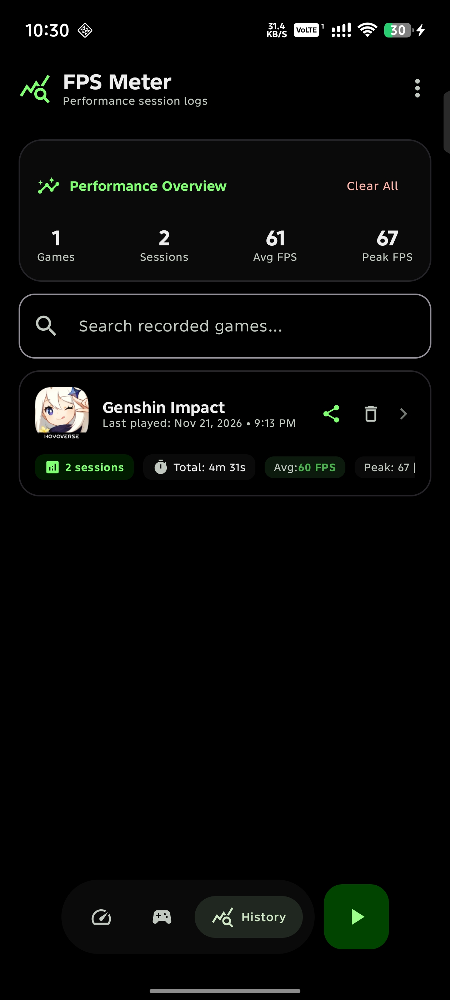
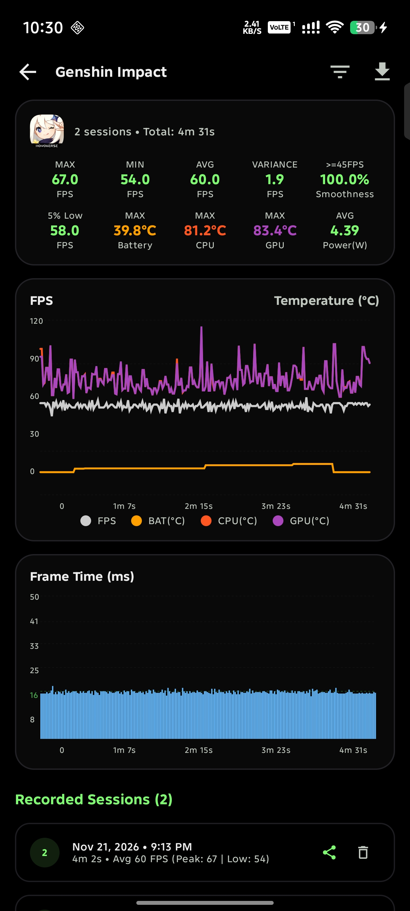

# FPS Meter Android v3.7

### What's Changed
- Added a game analytics screen in History with a ten-metric summary card, an interactive framerate and temperature chart, and a frame time chart ([#62](https://github.com/rdevz-ph/FPS-Meter-Android/issues/62)).
- Added a CSV export button in game analytics to save performance records to local storage or share them with other applications.
- Fixed an issue where Magisk was misidentified as KernelSU due to version string matching.

### Release Highlights

| Game History Screen | Game Analytics Screen |
| :---: | :---: |
|  |  |

For the complete release history, see [CHANGELOG.md](https://github.com/rdevz-ph/FPS-Meter-Android/blob/main/CHANGELOG.md). For known Android system behaviors and limitations, see [KNOWN_ISSUES_AND_LIMITATIONS.md](https://github.com/rdevz-ph/FPS-Meter-Android/blob/main/KNOWN_ISSUES_AND_LIMITATIONS.md).

### Features
- Choice between Choreographer and SurfaceFlinger FPS measurement providers
- Automatic Graphics API detection (Vulkan and OpenGL ES)
- Two overlay styles: default compact pill and multi-row MSI Afterburner Style (RTSS) telemetry layout
- Samsung-style pill-shaped overlay with cyan labels and white values
- Real-time FPS, frame time (MS), RAM usage, battery power (watts and current), and multi-metric temperature monitoring (CPU, GPU, SoC, and Battery)
- Adaptive layout dynamically scaling across lines, with a single-line mode option for tablets and landscape gaming
- Dynamic FPS color coding (green, yellow, orange, red) based on performance thresholds
- In-memory per-game FPS session recording with dedicated History screen
- Interactive floating assistive bubble with in-game quick control menu
- Six preset positions (top/bottom left/center/right) with manual drag support
- Light and dark mode themes
- Multi-language support (English and Simplified Chinese) with in-app language switcher
- Adjustable text size and overlay opacity
- Optional Root Mode and Shizuku integration for one-tap permission grant, SurfaceFlinger game FPS, and hardware thermal monitoring
- Quick Settings status bar tile and automated game detection via Accessibility Service

### Requirements
- Android 8.0+ (API 26)
- Overlay Permission (SYSTEM_ALERT_WINDOW)
- Shizuku or Root (optional, required for SurfaceFlinger real game FPS and SoC temperature monitoring)

### Installation & Setup Guides
Download the APK from the assets below and enable the "Display over other apps" permission when prompted.

> [!NOTE]
> **Which APK should I download?**
> - **Release APK (`FPS-Meter-*-release.apk`) [Recommended]:** Signed with the developer's official release key. Use this build if you want seamless in-place updates from GitHub in the future without needing to reinstall.
> - **Debug APK (`FPS-Meter-*-debug.apk`):** Signed with the default Android/Google SDK debug key generated by automated CI builds. Useful for quick testing, but switching to a release build in the future will require uninstalling first due to Android's signature verification.

If you encounter Play Protect installation blocks or Android 13+ restricted settings warnings when enabling features like Accessibility Service or Shizuku, follow the [Troubleshooting and Setup Guide](./tutorials/README.md).